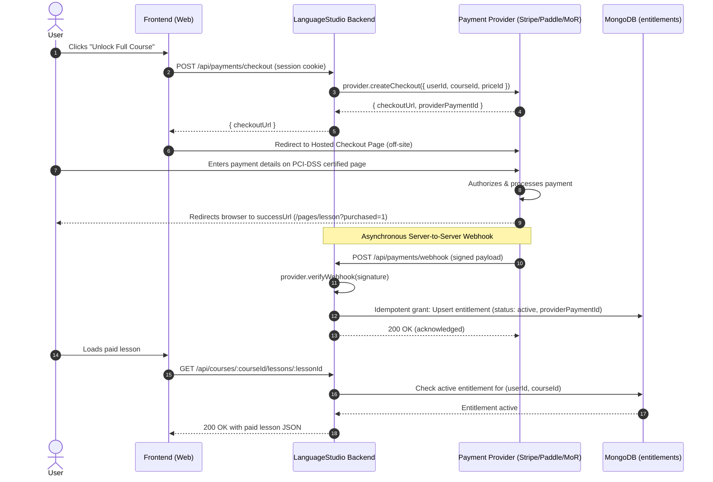

# Payment Integration & Paid Content Architecture

This document describes LanguageStudio's paid course architecture, payment integration workflow, server-side content protection, and pre-launch compliance checklist.

---

## 1. Architecture & Payment Flow

LanguageStudio uses an **offsite, asynchronous, webhook-driven entitlement model**. No real credit card or banking information ever touches LanguageStudio servers.

### High-Level Flow Diagram



### Critical Security Rule: Entitlement from Webhook ONLY

> [!IMPORTANT]
> **Entitlements are granted and revoked EXCLUSIVELY via verified webhooks (`POST /api/payments/webhook`), NEVER from the browser success redirect.**
>
> Browser redirects can be spoofed, altered, intercepted, or never executed (e.g. if the customer closes the browser tab before the redirect completes). Webhooks are cryptographically signed server-to-server HTTP requests guaranteed to arrive independently of client browser state.

---

## 2. Server-Side Content Enforcement

Paid courses maintain a "freemium" teaser model: **introductory lessons remain free, while advanced lessons require payment.**

### Content Separation

| Content Type | Location on Disk | Delivery Mechanism | Access Control |
| :--- | :--- | :--- | :--- |
| **Free Lessons** | `courses/<courseId>/lessons/*.json` | `express.static` (`/courses/...`) | Public / Anonymous |
| **Paid Lessons** | `paid-content/courses/<courseId>/lessons/*.json` | `GET /api/courses/:courseId/lessons/:lessonId` | Session Auth + Active Entitlement |
| **Course Metadata** | `courses/<courseId>/course.json` | `express.static` (`/courses/...`) | Public (declares `access` & `priceId`) |

1. **Static Delivery Barrier**: Paid content is stored outside any folder mounted with `express.static`. Attempting `GET /courses/it/lessons/italian-reading-2.json` directly returns `404 Not Found`.
2. **API Gating**: `GET /api/courses/:courseId/lessons/:lessonId`:
   - Checks session: If unauthenticated, returns `401 Unauthorized` (`code: 'AUTH_REQUIRED'`).
   - Checks entitlement: If user lacks an active entitlement, returns `403 Forbidden` (`code: 'ENTITLEMENT_REQUIRED'`).
   - If entitled: Reads the private lesson file from `paid-content/` and returns `200 OK`.
3. **Frontend Loaders**:
   - `course.js` detects 401/403 responses and throws structured lock errors.
   - `lesson.js` catches lock errors and renders a dedicated **Locked Lesson UI** with CTAs to log in or purchase.

---

## 3. Provider-Agnostic Interface

Payment integration is abstracted under `backend/service/src/services/payments/`:

```
backend/service/src/services/payments/
├── PaymentProvider.js      # Abstract interface
├── MockPaymentProvider.js  # Local stub for automated testing & development
└── index.js                # Provider registry & resolver
```

### Implementing a Real Provider (e.g., Stripe, Paddle, Lemon Squeezy)

To add a new provider, extend `PaymentProvider`:

```javascript
const PaymentProvider = require('./PaymentProvider');

class StripePaymentProvider extends PaymentProvider {
    get name() { return 'stripe'; }

    async createCheckout({ userId, courseId, priceId, successUrl, cancelUrl }) {
        const session = await stripe.checkout.sessions.create({
            mode: 'payment',
            client_reference_id: userId,
            line_items: [{ price: priceId, quantity: 1 }],
            success_url: successUrl,
            cancel_url: cancelUrl,
            metadata: { userId, courseId }
        });
        return {
            id: session.id,
            checkoutUrl: session.url,
            provider: 'stripe',
            providerPaymentId: session.payment_intent || session.id
        };
    }

    verifyWebhook(payload, signature, headers) {
        try {
            stripe.webhooks.constructEvent(payload, signature, process.env.STRIPE_WEBHOOK_SECRET);
            return true;
        } catch {
            return false;
        }
    }

    parseEvent(payload) {
        // Normalize Stripe event into standard LanguageStudio event
        return {
            eventType: payload.type === 'payment_intent.succeeded' ? 'payment_success' : 'payment_refunded',
            providerPaymentId: payload.data.object.id,
            userId: payload.data.object.metadata.userId,
            courseId: payload.data.object.metadata.courseId,
            status: payload.type === 'payment_intent.succeeded' ? 'active' : 'refunded',
            provider: 'stripe'
        };
    }
}
```

---

## 4. Webhook Idempotency & Entitlements

The `entitlements` MongoDB collection stores granted access:

```json
{
  "_id": "6724fa13e9a4b...",
  "userId": "usr_abc123",
  "courseId": "it",
  "status": "active",
  "provider": "mock",
  "providerPaymentId": "pay_mock_1731872400000_abc123",
  "createdAt": "2026-11-17T19:00:00.000Z",
  "expiresAt": null
}
```

- **Idempotency**: Webhook deliveries may retry multiple times upon network blips. All grants and revocations index on `providerPaymentId`. Duplicate `payment_success` webhooks detect existing records and return `200 OK` (`idempotent: true`) without creating duplicate records or modifying state.
- **Revocation**: Refund or cancellation webhooks update `status` to `'refunded'` or `'expired'`. Subsequent checks to `hasActiveEntitlement()` immediately return `false`.

---

## 5. Pre-Launch Compliance, Legal & Financial Checklist

Before activating real transactions in production, complete the following prerequisites:

### 1. Terms of Service & Terms of Sale
- [ ] **Digital Content Immediate Access Waiver**: Under EU Consumer Rights Directive (Directive 2011/83/EU), digital content access requires the consumer's explicit prior consent acknowledging that supply begins immediately and statutory right of withdrawal is waived upon access.
- [ ] **License Scope**: Define whether purchase grants a non-exclusive, non-transferable personal license or subscription.
- [ ] **Uptime & Service Availability**: Disclaimer of warranty regarding continuous availability.

### 2. Privacy Policy & Data Protection (GDPR / CCPA)
- [ ] **Zero Card Data Principle**: Explicitly state that card numbers (PAN), CVVs, and banking credentials are never processed or retained on LanguageStudio infrastructure.
- [ ] **Sub-processors**: List the payment provider (Stripe, Paddle, etc.) as a designated data processor for financial data.
- [ ] **Data Retention**: Retain transaction IDs and entitlement timestamps for legal tax compliance (typically 7–10 years depending on jurisdiction).

### 3. Refund Policy
- [ ] **Clear Refund Terms**: Standard 14-day refund window or explicit policy (e.g., full refund within 14 days if fewer than 3 lessons completed).
- [ ] **Chargeback Prevention**: Provide accessible billing support and clear statement descriptors (e.g. `LANGUAGESTUDIO.COM`) to minimize fraudulent chargeback disputes.

### 4. VAT, Sales Tax & Invoicing
- [ ] **EU VAT OSS (One Stop Shop) / MOSS**: Digital services sold to EU B2C consumers must charge the VAT rate of the buyer's country of residence.
- [ ] **US Sales Tax**: Economic nexus thresholds by state (e.g., \$100,000 or 200 transactions).
- [ ] **Automatic Receipts & Tax Invoices**: Receipts must include seller company legal name, VAT/registration number, buyer billing address, tax rate applied, and unique invoice number.

### 5. One-Time Payment vs. Subscription Models
- [ ] **One-Time Lifetime Pass**: Recommended for course packs. Lowest customer friction, zero recurring billing churn, no dunning email flows needed.
- [ ] **Subscription Model**: Requires recurring subscription management, renewal reminders, grace periods, card expiration notifications, and prorated plan adjustments.

### 6. Provider Selection by Business Registration Country
Your business incorporation country dictates which provider architecture is optimal:

| Provider Model | Examples | Best For | Tax Handling |
| :--- | :--- | :--- | :--- |
| **Merchant of Record (MoR)** | Paddle, Lemon Squeezy | EU/UK/US indie founders & early-stage startups without global tax infrastructure | **MoR handles 100% of global VAT/sales tax**, invoicing, and remittance. You receive net payouts. |
| **Payment Gateway** | Stripe, Adyen, Mollie | Established businesses with local tax registrations & domestic entity | Lower processing fee (~1.4%–2.9%), but you must register for VAT/sales tax in every country yourself (or add Stripe Tax). |

- **If registered in Ukraine / CEE / EU as a sole proprietor (FOP/Freelancer)**: A Merchant of Record (Paddle or Lemon Squeezy) drastically reduces tax administration because they act as the legal reseller.
- **If registered as a US LLC / UK Ltd / EU Sp. z o.o.**: Stripe or Paddle are fully supported.
